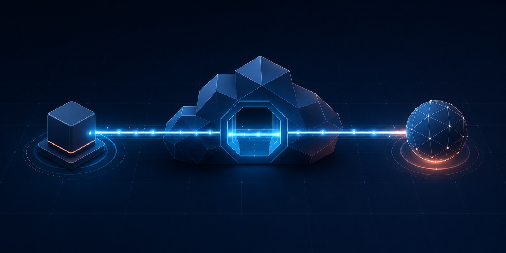

# cf-vless



[](https://github.com/BaiqingL/cf-vless/actions/workflows/ci.yml)
[](https://github.com/BaiqingL/cf-vless/actions/workflows/codeql.yml)
[](LICENSE)

A narrow, self-hosted TCP tunnel for a Cloudflare account and domain you
control.

[Documentation](docs/README.md) · [Security](SECURITY.md) ·
[Compatibility](COMPATIBILITY.md) · [Contributing](CONTRIBUTING.md)

> [!IMPORTANT]
> Cloudflare terminates the public TLS connection and can observe the VLESS
> header and tunneled bytes. `cf-vless` is not an anonymity system. Use
> end-to-end application encryption such as HTTPS or SSH for sensitive traffic.

## What it is

`cf-vless` deploys one TypeScript Worker and manages its private VLESS
credentials, Custom Domain, client configurations, rotation, and removal from a
Go CLI.

```text
VLESS v0 TCP client
        │
        └── WebSocket over Cloudflare-managed TLS
                         │
                         ▼
                 Cloudflare Worker ── TCP ── public destination
                    TLS ends here
```

| Included | Deliberately out of scope |
| --- | --- |
| VLESS v0 TCP `CONNECT` | UDP and Mux |
| WebSocket transport | REALITY, XTLS/Vision, XHTTP, and gRPC |
| One fail-closed Worker | Multi-user control plane or general VPN |
| Xray, sing-box, and Mihomo configs | Anonymity or censorship-resistance guarantee |
| Credential rotation and owned-resource removal | VPS, Spectrum, or alternate transport fallback |

## Quick start

You need:

- a Cloudflare account with an active Cloudflare-managed DNS zone;
- a dedicated hostname with no conflicting DNS record or Worker Route;
- exactly `cf 0.2.0`, authenticated to the target account;
- Go 1.26 or newer (required by the pinned Xray source);
- Node.js `^22.18.0` or `>=24.0.0`, plus npm 11; and
- Git and `rg`.

Clone recursively because the pinned, unmodified Xray source is part of the
verification boundary:

```sh
git clone --recurse-submodules https://github.com/BaiqingL/cf-vless.git
cd cf-vless
make deps
make check
make build
```

Authenticate both Cloudflare tools, inspect the target, and initialize private
state:

```sh
cf auth login
npm --prefix worker exec -- wrangler login --cwd worker

./bin/cf-vless doctor \
  --zone example.com \
  --hostname edge.example.com

./bin/cf-vless init \
  --zone example.com \
  --hostname edge.example.com \
  --name "My Edge"
```

Review the exact plan before publishing:

```sh
./bin/cf-vless deploy --dry-run
./bin/cf-vless deploy
./bin/cf-vless status
./bin/cf-vless config --output ./client-configs
```

The generated `sing-box.json` is a system-wide TUN profile. Run it with the
platform privileges required to create a TUN interface, or import it into a
sing-box application that manages those privileges. It routes private and
mainland China IP ranges directly and sends all other supported TCP traffic
through the Worker. See the [client configuration guide](docs/client-configurations.md#sing-box-routing-policy).

`sing-box.gif` is the same complete profile in the official animated QRS
format. Open the animation and keep it playing while using the QR scanner in a
current sing-box app; the scanner collects its looping frames and imports the
local profile without publishing the configuration at a remote URL.

```sh
sudo sing-box run -c ./client-configs/sing-box.json
```

`.cf-vless/` and `client-configs/` contain bearer credentials. They are created
with owner-only permissions and ignored by Git. Never paste either directory
into an issue, log, or chat.

See the [deployment guide](docs/deployment.md) before the first live deploy. The
optional legacy Global API Key fallback is intentionally documented there,
away from the normal path.

## Test the tunnel

The live gate uses endpoints you select and trust; the project does not operate
public probe services.

```sh
./bin/cf-vless test \
  --clients all \
  --https-url https://probe.example/ \
  --download-url https://probe.example/download \
  --upload-url https://probe.example/upload \
  --tcp-echo echo.example:443
```

The upload service must echo the exact ASCII body. The TCP service must be
line-oriented and echo a complete newline-framed payload. Replace every
`.example` value before running the command.

The current executable-client baseline covers Xray-core, sing-box, and Mihomo.
Shadowrocket URI and QR syntax are checked, but real-device import and
connection remain unverified. Exact versions and evidence are in
[COMPATIBILITY.md](COMPATIBILITY.md).

## Design boundaries

- Authentication requires the UUID and randomized WebSocket path; the path is
  not treated as a credential by itself.
- Domains are resolved through DNS-over-HTTPS before `connect()`. Any unsafe
  answer rejects the complete result set.
- Private, loopback, link-local, metadata, Cloudflare, self, reserved, and
  disallowed-port destinations fail closed.
- Pre-authentication and relay queues are bounded. Handshake, connect, idle,
  and absolute session timeouts are explicit.
- Persistent Worker observability, invocation logs, and sampling are disabled
  by default.
- Rotation and removal use private checkpoints and only operate on resources
  whose stored ownership provenance still matches Cloudflare.

Read the [threat model](THREAT_MODEL.md), [privacy model](PRIVACY.md), and
[known limitations](LIMITATIONS.md) before relying on the service.

## Documentation

| Guide | Use it for |
| --- | --- |
| [Documentation index](docs/README.md) | Find operator, security, and maintainer material |
| [Deployment](docs/deployment.md) | Bootstrap, publish, rotate, and remove safely |
| [CLI reference](docs/cli.md) | Commands, exit statuses, and probe contracts |
| [Client configurations](docs/client-configurations.md) | Import and validate generated clients |
| [Troubleshooting](docs/troubleshooting.md) | Fail-closed recovery procedures |
| [Architecture](docs/architecture.md) | Components and trust boundaries |
| [Maintenance](docs/maintenance.md) | Dependency, runtime, and release updates |

## Development

```sh
make deps
make format
make check
make release-check
```

`make check` runs Go race tests, Worker tests, formatting, type checks, static
analysis, vulnerability checks, Markdown lint, and the repository secret scan.
`make release-check` additionally validates both non-mutating Worker build
paths. See [CONTRIBUTING.md](CONTRIBUTING.md) for review expectations.

## Project status and affiliation

This project is experimental and optimized for one personal deployment. APIs,
Free-plan limits, clients, and `cf` CLI behavior can change. Review the dated
research before each release.

`cf-vless` is an independent project. It is not affiliated with, sponsored by,
or endorsed by Cloudflare, Project X, Xray-core, sing-box, Mihomo, or
Shadowrocket. Product names and trademarks belong to their respective owners.

## License

Released under the [Apache License 2.0](LICENSE). See
[THIRD_PARTY_NOTICES.md](THIRD_PARTY_NOTICES.md) for independently licensed
dependencies and the pinned Xray source.
